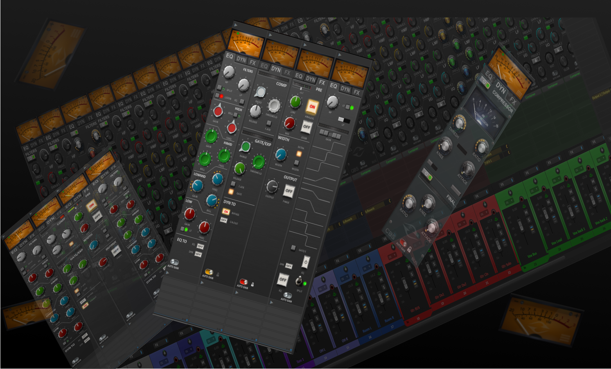

# StripLink - Plugin Manual

---

*A comprehensive guide to StripLink v2 - turning REAPER's mixer into a dynamic analog-style console.*

---

Developed by: Robert Korenjak (Wormhole Labs)  
**Special thanks to:** John Sawan for his invaluable ideas, continuous feedback, and creative contributions throughout the development of StripLink.

### Table of Contents

* [1. Introduction and Concept](01-introduction.md)
* [2. Basic Controls & Navigation](02-basic-controls.md)
* [3. Layout Builder (Module Version Only)](03-layout-builder.md)
* [4. Parameter Mapping & Customization](04-parameter-mapping.md)
* [5. Saving & Loading, FX Chains & Track Templates](05-saving-loading.md)
* [6. StripLink Aggregator, Metering & Auto-Gain](06-aggregator-metering.md)
